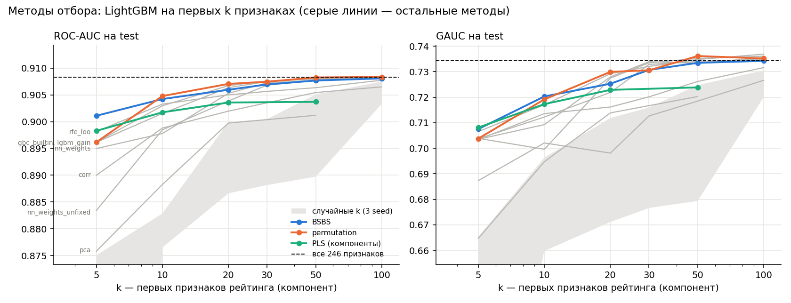

# Можно ли автоматизировать построение признаков для ранжирования в рекомендациях

Ранжирующие модели в рекомендательных системах часто — градиентный бустинг на признаках, которые придумывают люди:
сколько раз пользователь слушал трек за 7 дней, какая доля дослушанных у артиста за месяц и т. д.
Это исследование проверяет, можно ли заменить ручной выбор окон, связей и статистик автоматическим перебором
и отбором признаков без потери качества, и какие методы отбора для этого подходят.

**Коротко о результатах** (Yambda-50M, задача «дослушает ли пользователь трек, поставленный рекомендациями»):

1. **Сильный бейзлайн**: LightGBM на 246 ручных признаках — ROC-AUC 0.9087, GAUC 0.736 на test (лучшая простая
   эвристика — 0.867). Признаки считаются строго на момент решения; найдена и устранена утечка, из-за которой
   первая версия давала AUC 0.985 (в данных время прослушивания — его конец, а не начало).
2. **Автоматическая генерация** перебором по грамматике «связь × тип событий × окно × статистика» даёт 720 признаков.
   Без участия человека пул чуть лучше ручного набора по LogLoss и AUC (0.3483 против 0.3491, 0.9077 против 0.9073;
   устойчиво по 3 seed), и 100 признаков из него, отобранных BSBS, заменяют все 246 ручных. Но по NDCG внутри сессии
   ручной набор лучше на 0.002–0.003. Выигрыш маленький: главные сигналы ручной набор уже содержал.
3. **Ответ на «почему 7 дней»**: отбор почти не берёт окно 7 дней. Нужны два масштаба — короткий (последние
   3–10 треков, 1 ч, 3 д) и длинный (30 д, 90 д, всё время); промежуточные окна дублируют соседей.
4. **Альтернатива признакам — трансформер над сырой историей событий** (внимание по кандидату, без ручных признаков)
   уступает бустингу: AUC 0.89 против 0.907. Его прогноз почти ничего не добавляет к агрегатам. Причина — короткая
   память: 64 последних события — это медианно сутки, а агрегаты видят 300 дней.
5. **Отбор признаков**: 30–50 признаков из 246 держат почти всё качество. При малых k (5–10) лучший метод — авторский
   **BSBS (Batch Sequential Backward Selection, последовательный обратный пакетный отбор)** [1]: он не берёт дубликаты
   среди мультиколлинеарных признаков, а его быстрая точная реализация строит рейтинг 720 признаков за 100 с. При k ≥ 20 лучше рейтинги на деревьях (permutation,
   встроенная важность). PCA и PLS проигрывают отбору. Порядок методов воспроизводится на втором разбиении по времени.

## Структура

| Путь | Что там |
|---|---|
| `src/data/yambda.py` | загрузка данных, момент решения, разбиение по времени |
| `src/features/engine.py` | расчёт признаков на момент решения (накопленные суммы + as-of join) |
| `src/features/handcrafted.py`, `src/features/auto.py` | ручной набор и грамматика генератора |
| `src/selection/`, `src/models/linear_selection.py` | методы отбора: BSBS, RFE, веса нейросети, важность бустинга, предобработка |
| `src/preprocessing/pca.py`, `pls.py` | PCA и PLS |
| `src/seq/` | модель над историей событий: сборка истории, трансформер с вниманием по кандидату |
| `src/eval/` | итоговая модель (LightGBM) и метрики |
| `scripts/` | сборка признаков, бейзлайн, сравнения, графики |
| `tests/` | 45 тестов: корректность агрегатов, отсутствие утечек, точность быстрых формул отбора, метрики |
| `experiments/` | результаты: `baseline*/`, `selection*/`, `auto/`, `seq/` |

## Данные

[Yambda-50M](https://huggingface.co/datasets/yandex/yambda) (Яндекс Музыка): 10 000 пользователей с полной историей,
47,8 млн событий за 301 день, 934 тыс. треков. Типы событий: прослушивание (с долей прослушанного), лайк, дизлайк, их отмены.
У каждого события флаг `is_organic`: 0 — трек поставила рекомендательная система, 1 — пользователь выбрал сам.
Трек связан с артистом и альбомом (у трека с несколькими берётся наименьший id).

## Задача

Пример — алгоритмическое прослушивание (`is_organic = 0`): система поставила трек, пользователь его дослушал или пропустил.
Метка `label = 1`, если `played_ratio_pct ≥ 50` (определение «прослушано» от авторов датасета). Это аналог «клика после показа».
Кандидаты заданы логом: модель переупорядочивает треки, которые система действительно выдала, поэтому сравнение методов
не зависит от генерации кандидатов.

**Разбиение по времени** (дни, `src/data/yambda.py::Split`): train 266–286, valid 287–293, test 294–300.
Признаки всегда считаются по всей истории до момента решения. Из train берётся 50% примеров (ограничение памяти ноутбука;
история пользователей не режется). Примеров: train 1,04 млн, valid 0,73 млн, test 0,73 млн; доля дослушанных 0,68–0,71.

**Метрики** (`src/eval/metrics.py`): LogLoss, ROC-AUC; GAUC — AUC внутри пользователя (убирает выигрыш от «кто вообще чаще
дослушивает»); NDCG@10 внутри сессии по выданным трекам (сессии с обоими классами, равные прогнозы — в случайном порядке).

## Признаки на момент решения

`src/features/engine.py`. Признак задаётся спецификацией: ключ (пользователь, трек, артист, альбом, пары с пользователем,
текущая сессия) × фильтр событий × окна × значения. Для момента t учитываются события с `timestamp ≤ t`; окно w — `[t − w, t]`.
Считается через накопленные суммы по группе ключа и as-of join — без циклов по строкам. Накопленные суммы целочисленные,
поэтому точные. Признаки с пользователем в ключе считаются по частям пользователей (память).

Проверки (`tests/test_engine.py`, `tests/test_targets.py`):
- каждый агрегат совпадает с наивным пересчётом по строкам;
- случайная перезапись будущих событий не меняет признаки;
- удлинение целевого прослушивания не меняет его признаки.

Ручной набор (`src/features/handcrafted.py`), 246 признаков:

| Группа | Примеры |
|---|---|
| user | число прослушиваний и доля дослушанных за 1 ч / 1 д / 7 д / 30 д / всё время, доля алгоритмических, лайки |
| item, artist_album | популярность и доля дослушанных по всем пользователям выборки, лайки, возраст трека в логе |
| user_item | сколько раз слушал трек, как дослушивал, когда последний раз, лайкнут ли |
| user_artist_album | то же через артиста и альбом; доля артиста в прослушиваниях пользователя |
| context | текущая сессия до момента решения, последние 5/20/100 прослушиваний, предыдущий трек, час, длина трека |

## Бейзлайн: результаты

LightGBM (`src/eval/lgbm_eval.py`: 127 листьев, lr 0.05, early stopping по valid), 246 признаков, 3 seed.
Test, среднее ± std по seed:

| Модель | LogLoss | ROC-AUC | GAUC | NDCG@10 |
|---|---|---|---|---|
| постоянный прогноз | 0.6072 | 0.500 | 0.500 | 0.735 |
| доля дослушанного трека по всем пользователям | 0.6366 | 0.646 | 0.558 | 0.742 |
| доля дослушанного у пользователя среди алгоритмических | 0.4640 | 0.816 | 0.446 | 0.615 |
| доля дослушанного за последние 20 прослушиваний | 0.4912 | 0.867 | 0.625 | 0.681 |
| **LightGBM, все признаки** | **0.3403 ± 0.0001** | **0.9087 ± 0.0001** | **0.7364 ± 0.0002** | **0.7742 ± 0.0006** |

**Гиперпараметры подобраны по valid** (`scripts/train_baseline.py --grid`, `experiments/baseline_grid/`): сетка
num_leaves ∈ {63, 255} × min_data_in_leaf ∈ {100, 1000}, lr 0.1. Valid LogLoss: 0.34865 / 0.34818 / 0.34874 / 0.34852;
лучшие — 63 листа и 1000. С ними на test 0.3402 / 0.9087 / 0.7363 — то же, что у исходных параметров
(0.3403 / 0.9087 / 0.7364). Модель к этим параметрам нечувствительна, поэтому все сравнения ниже сделаны с одними
фиксированными параметрами — одинаковыми для всех вариантов.

Обучение 130–160 с на 6 потоках (1,04 млн строк), прогноз на 0,73 млн строк — 4 с.
Разброс между seed (~0.0001 AUC) много меньше различий между вариантами ниже.

**Абляции** (lr 0.1, 1 seed, test; «все» — 0.3410 / 0.9083 / 0.7344 / 0.7717):

| Группа | Признаков | AUC без группы | GAUC без группы | AUC только группа | GAUC только группа |
|---|---|---|---|---|---|
| context (сессия, последние k, предыдущий трек) | 23 | **0.9065** | **0.7307** | 0.9019 | 0.7077 |
| user | 73 | 0.9068 | 0.7336 | 0.9017 | 0.6972 |
| user_artist_album (косвенные связи) | 43 | 0.9079 | 0.7322 | 0.7867 | 0.5737 |
| user_item (прямые связи) | 42 | 0.9077 | 0.7330 | 0.7018 | 0.5512 |
| item | 41 | 0.9083 | 0.7340 | 0.6605 | 0.5645 |
| artist_album | 24 | 0.9083 | 0.7356 | 0.6531 | 0.5576 |

Что видно:
- **Главный сигнал — текущее состояние пользователя**: дослушал ли он предыдущий трек и несколько последних
  (`prev__ratio`, `u__listen__last_ratio`, `u__last5_listen__mean_ratio` — первые три по gain).
  23 признака контекста дают AUC 0.902 из 0.909. Это «режим скипов»: пользователь листает или слушает.
- **Персональное упорядочивание (GAUC)** держится на связях пользователя с треком и артистом: без них GAUC падает
  на 0.001–0.002, хотя общий AUC почти не меняется. Внутри одного пользователя разница между треками — в истории с ними.
- **Свойства трека и артиста сами по себе слабы** (AUC 0.65–0.66) и почти полностью перекрываются остальными группами.
- Группы сильно дублируют друг друга: убрать любую одну — потеря не больше 0.002 AUC. Поэтому есть смысл в отборе:
  компактный набор, скорее всего, держит почти всё качество.

## Отбор признаков

Абляции показали, что группы признаков сильно дублируют друг друга. Вопрос: сколько признаков на самом деле нужно
и какой метод отбора находит компактный набор лучше. Каждый метод строит **рейтинг** признаков только по train;
проверка — одна и та же модель (LightGBM, lr 0.1, early stopping по valid) на первых k признаках рейтинга.
Базовые линии — все признаки и случайные k (3 seed). Выбор варианта — по valid, test — итоговая оценка.

### Методы

| Метод | Как строится рейтинг | Предобработка |
|---|---|---|
| **BSBS** (Batch Sequential Backward Selection) — авторский метод [1] | На каждой итерации обучается Ridge на всех оставшихся признаках и модели без каждого признака по отдельности; выбрасывается пакет (10% оставшихся) тех, без кого ошибка выросла меньше всего. Ранг 1 — признак, продержавшийся дольше всех. Ошибка — 5-fold CV внутри train. alpha = 251 подобран LOO на train на всех признаках | `LinearPreprocessor` |
| RFE на Ridge | выбрасывается пакет с наименьшими \|β\|; alpha заново по LOO на каждом шаге | `LinearPreprocessor` |
| Веса нейросети | сеть с одним скрытым слоем (32, ReLU, BCE, веса лучшей эпохи по valid); важность i = Σ\|W2\|·\|W1[:, i]\|; 5 запусков, рейтинг по числу попаданий в топ-30 | `LinearPreprocessor` + z-score |
| Встроенная важность бустинга | `GradientBoostingClassifier.feature_importances_` на 100 тыс. строк train | `LinearPreprocessor` |
| Gain LightGBM | важность в модели бейзлайна | нет |
| Permutation importance | `HistGradientBoostingClassifier` обучается на ранней части train (до дня 281), признаки перемешиваются на поздней; важность — рост LogLoss | нет |
| Корреляция с меткой | \|r\| признака с меткой | `LinearPreprocessor` |
| PCA, PLS | преобразования вместо отбора: модель на первых k компонентах | `LinearPreprocessor` + z-score |

### BSBS — Batch Sequential Backward Selection

**BSBS** (Batch Sequential Backward Selection, последовательный обратный пакетный отбор) — метод отбора входных
признаков, предложенный автором исследования для задач с сильно мультиколлинеарными признаками [1]. Идея:
важность признака — не его вес и не связь с целью по отдельности, а то, **насколько хуже становится модель без него
при всех остальных признаках**. Признак, у которого есть почти точная копия, по этому критерию не нужен —
и выбрасывается раньше, чем уникальный. Отбор идёт последовательно пакетами:

1. на оставшихся p признаках обучается модель и p моделей без каждого признака по отдельности;
2. для каждого признака считается рост ошибки без него Δⱼ = MSE₋ⱼ − MSE на оценочной выборке (здесь — 5-fold CV внутри train);
3. выбрасывается пакет признаков с наименьшими Δⱼ — доля 10% от оставшихся, поэтому верх рейтинга ранжируется подробно,
   по одному признаку;
4. повторяется, пока признаки не кончатся; ранг 1 — признак, продержавшийся дольше всех.

В этом исследовании BSBS применён к ранжированию в рекомендациях: признаки — агрегаты по пересекающимся временным
окнам, которые коллинеарны по построению (число прослушиваний за 7 д входит в число за 30 д). Именно здесь
сильная сторона метода видна лучше всего (раздел «Результаты»): при малом числе признаков BSBS выигрывает у всех
методов, потому что не тратит места в наборе на копии одного сигнала.

### Результаты



ROC-AUC на test, основное разбиение; все 246 признаков — **0.9083**. Случайные k — среднее по 3 seed.

| Метод | k=5 | 10 | 20 | 30 | 50 | 100 | Время рейтинга |
|---|---|---|---|---|---|---|---|
| BSBS | **0.9011** | 0.9042 | 0.9060 | 0.9070 | 0.9077 | 0.9081 | 12 с |
| permutation | 0.8962 | **0.9048** | **0.9071** | 0.9075 | **0.9083** | **0.9084** | 15 мин |
| встроенная важность GB | 0.8962 | 0.9030 | 0.9067 | **0.9076** | 0.9079 | **0.9084** | 10 мин |
| gain LightGBM | 0.8961 | 0.9015 | 0.9064 | 0.9075 | 0.9081 | 0.9083 | из бейзлайна |
| веса нейросети | 0.8950 | 0.8978 | 0.9053 | 0.9073 | 0.9077 | 0.9083 | 3.5 мин |
| веса нейросети без обнуления констант | 0.8834 | 0.8985 | 0.9039 | 0.9068 | 0.9077 | 0.9083 | 4.5 мин |
| RFE (alpha по LOO) | 0.8981 | 0.9033 | 0.9050 | 0.9057 | 0.9064 | 0.9077 | 4 с |
| корреляция с меткой | 0.8900 | 0.8988 | 0.9020 | 0.9035 | 0.9054 | 0.9065 | < 1 с |
| PLS (k компонент) | 0.8983 | 0.9017 | 0.9036 | — | 0.9037 | — | 45 с |
| PCA (k компонент) | 0.8758 | 0.8883 | 0.8997 | — | 0.9012 | — | 21 с |
| случайные k | 0.7392 | 0.8807 | 0.8935 | 0.8955 | 0.8992 | 0.9050 | — |

**Повтор на разбиении, сдвинутом на 7 дней** (train 259–279, valid 280–286, test 287–293; признаки, бейзлайн
и рейтинги построены заново; все признаки — 0.9070):

| Метод | k=5 | 10 | 20 | 30 | 50 | 100 |
|---|---|---|---|---|---|---|
| BSBS | **0.8998** | **0.9023** | 0.9053 | 0.9058 | 0.9064 | 0.9066 |
| permutation | 0.8946 | 0.9020 | **0.9060** | **0.9063** | **0.9069** | **0.9070** |
| встроенная важность GB | 0.8946 | 0.9014 | 0.9048 | 0.9062 | 0.9065 | 0.9069 |
| gain LightGBM | 0.8945 | 0.9019 | 0.9050 | 0.9062 | 0.9067 | 0.9069 |
| веса нейросети | 0.8934 | 0.8972 | 0.9043 | 0.9057 | 0.9063 | 0.9069 |
| RFE (alpha по LOO) | 0.8950 | 0.9012 | 0.9031 | 0.9038 | 0.9053 | 0.9065 |
| корреляция с меткой | 0.8880 | 0.8973 | 0.9002 | 0.9019 | 0.9039 | 0.9051 |
| PLS (k компонент) | 0.8966 | 0.8998 | 0.9020 | — | 0.9022 | — |
| PCA (k компонент) | 0.8737 | 0.8865 | 0.8985 | — | 0.8995 | — |
| случайные k | 0.7346 | 0.8786 | 0.8916 | 0.8936 | 0.8975 | 0.9034 |

Порядок методов на двух разбиениях почти одинаков: ранговая корреляция Спирмена по 9 методам — 0.98 (k = 5),
0.87 (10), 0.93 (20), 0.86 (30), 1.0 (50). Полные таблицы, в том числе GAUC, LogLoss и NDCG, —
`experiments/selection/results.csv` и `experiments/selection_shift7/results.csv`.

Что видно:
1. **Отбор оправдан: 30–50 признаков из 246 держат почти всё качество.** Permutation на 50 признаках — как все 246
   на обоих разбиениях; на 30 — минус 0.0007–0.0008 AUC. Обучение на 30 признаках — 14 с против 72 с.
   Любой рейтинг намного лучше случайного набора того же размера (k = 30: 0.902–0.908 против 0.894–0.896).
2. **При малых k (5–10) лучший BSBS, при k ≥ 20 — методы на деревьях** — на обоих разбиениях. Первые пять признаков
   всех методов на деревьях — один и тот же сигнал пять раз («доля прослушанного у последних треков»: `prev__ratio`,
   `u__listen__last_ratio`, `u__last5/20_listen__mean_ratio`, `u__listen__mean_ratio__1h`). BSBS оставляет признак, только
   если без него растёт ошибка модели на всех остальных, поэтому дубликаты выбрасывает и уже в пятёрке добирает
   другие сигналы: отклик пользователя на рекомендации за 30 дней, сколько раз он дослушивал этот трек.
   Устойчивость обратного пакетного отбора к мультиколлинеарности входных признаков разобрана в [1].
   При k ≥ 20 важнее нелинейная полезность, и рейтинги, построенные деревьями, лучше подходят итоговой модели-дереву.
3. **На k = 100 рейтинги неотличимы от полного набора** (разница ≤ 0.0004 AUC). Выбор k по valid LogLoss у всех
   рейтингов даёт k = 100: компактный набор полный не превосходит, но и не уступает ему.
4. **PLS и PCA проигрывают отбору.** PLS хорош на 5 компонентах (компоненты сразу смотрят на метку), но выходит
   на полку 0.902–0.904: линейные проекции теряют пороги, которые нужны деревьям. PCA метку не видит и хуже всех при
   любом k. Кроме того, компоненты лишают модель интерпретируемости.
5. **RFE уступает BSBS при всех k.** RFE смотрит на \|β\| одной модели, BSBS — на то, как модель предсказывает без
   признака. Среди почти коллинеарных окон вес делится между копиями произвольно: в верх рейтинга RFE попала пара
   почти одинаковых `i__listen__cnt__all` и `i__listen__sum_listened__all`. (Значения alpha по шагам не сохранялись,
   поэтому объяснение — гипотеза.)
6. **Корреляция с меткой — худший из рейтингов** (берёт пять копий одного сигнала), но лучше случайного.

**Дефект в отборе по весам сети.** У признаков `prev__gap` и `u__listen__since_last` на момент решения одно значение
(1 с). Наивная формула ставила их на 4–5 место: после стандартизации вход постоянный, градиент по его весам нулевой
(или это константа ±1, если std посчитан как 1e-16 вместо 0), и \|W1\| остаётся случайным с инициализации.
Обнуление важности у столбцов с max = min подняло AUC при k = 5 с 0.8834 до 0.8950. Проверка `std == 0` такие
столбцы не ловит: у 300 тыс. одинаковых значений `log1p(1)` std = 1.1e-16.

**Ограничения.** 1 seed итоговой модели на точку (разброс между seed у полной модели ~0.0001 AUC); рейтинги
построены на 300 тыс. строк train из 1,04 млн; различия меньше ~0.0005 AUC между методами не устойчивы между разбиениями.

## Автоматическая генерация признаков

Ручной набор отражает решения человека: какие окна (1 ч, 1 д, 7 д, 30 д), какие связи, какие статистики.
Генератор (`src/features/auto.py`) заменяет эти решения полным перебором по грамматике
**связь × тип событий × окно × статистика**, а что из этого нужно — решает отбор на train.

| Элемент грамматики | Значения |
|---|---|
| связь | пользователь; трек, артист, альбом; пары пользователя с треком, артистом, альбомом; текущая сессия |
| тип событий | прослушивания (все / алгоритмические / органические), лайки, дизлайки |
| окно | для пользовательских связей 1 ч, 6 ч, 1 д, 3 д, 7 д, 14 д, 30 д, 90 д, всё время; для трека, артиста, альбома 1 д, 7 д, 30 д, 90 д, всё время |
| статистика | число событий, доля дослушанных, средняя доля прослушанного, доля алгоритмических, время с последнего и первого события, последние k = 3 … 200 прослушиваний |
| автоматические отношения | доля связи в активности пользователя (для каждой пары и окна), тренд между соседними окнами, доля лайков и дизлайков |

Получается **720 признаков** (36 спецификаций), из них 555 нет в ручном наборе. Все считаются тем же движком на момент
решения, поэтому проверки на утечки покрывают их автоматически. Сборка пула — 11 минут на CPU.

Сравнение на одних и тех же строках (train — 400 тыс. примеров, valid и test — все примеры половины пользователей,
`scripts/compare_auto.py`), та же итоговая модель. Рейтинги построены по train.

| Вариант | Признаков | LogLoss (valid) | LogLoss (test) | ROC-AUC (test) | GAUC (test) | Обучение |
|---|---|---|---|---|---|---|
| все ручные | 246 | 0.3491 | 0.3491 | 0.9073 | 0.7292 | 25 с |
| ручные, первые 50 по gain | 50 | 0.3491 | 0.3492 | 0.9072 | 0.7299 | 7 с |
| все автоматические | 720 | 0.3486 | 0.3484 | 0.9077 | 0.7265 | 66 с |
| автоматические, первые 30 по BSBS | 30 | 0.3510 | 0.3504 | 0.9066 | 0.7263 | 4 с |
| автоматические, первые 100 по BSBS | 100 | 0.3487 | 0.3483 | 0.9078 | 0.7281 | 9 с |
| автоматические, первые 200 по gain | 200 | 0.3483 | 0.3481 | 0.9078 | 0.7296 | 22 с |
| ручные + 30 лучших новых автоматических | 276 | **0.3480** | **0.3481** | 0.9078 | 0.7275 | 27 с |
| ручные + 100 лучших новых автоматических | 346 | 0.3483 | 0.3481 | **0.9079** | 0.7288 | 34 с |

Все варианты — `experiments/auto/results.csv` (BSBS и gain на k = 10 … 200 для обоих пулов).

**3 seed итоговой модели** (`experiments/auto/seeds.csv`, среднее ± std):

| Вариант | LogLoss (test) | ROC-AUC (test) | GAUC (test) | NDCG@10 (test) |
|---|---|---|---|---|
| все ручные (246) | 0.3491 ± 0.0001 | 0.9073 ± 0.0001 | 0.7279 ± 0.0013 | **0.7651 ± 0.0004** |
| автоматические, первые 100 по BSBS | 0.3483 ± 0.0000 | 0.9077 ± 0.0000 | 0.7284 ± 0.0004 | 0.7620 ± 0.0003 |
| ручные + 30 лучших новых автоматических | **0.3481 ± 0.0001** | **0.9078 ± 0.0001** | 0.7292 ± 0.0015 | 0.7630 ± 0.0006 |

Выигрыш автоматических признаков по LogLoss (−0.0008…−0.0010) и AUC (+0.0004…+0.0005) в 5–10 раз больше разброса
между seed. GAUC различается в пределах разброса. **NDCG@10 внутри сессии у ручного набора выше** (0.7651 против
0.7620–0.7630) — тоже устойчиво: автоматические признаки лучше калибруют вероятность в целом, но хуже упорядочивают
треки внутри одной сессии.

**Какие окна выбирает отбор** (`experiments/auto/summary.json`). Среди первых 100 признаков BSBS:

| Окно | 1 ч | 6 ч | 1 д | 3 д | 7 д | 14 д | 30 д | 90 д | всё время | последние k |
|---|---|---|---|---|---|---|---|---|---|---|
| в пуле | 51 | 51 | 87 | 51 | 87 | 51 | 87 | 87 | 105 | 33 |
| в первых 100 BSBS | 10 | 6 | 5 | **13** | **2** | 4 | **15** | 8 | **16** | 11 |
| в первых 100 gain | 4 | 3 | 2 | 2 | 3 | 4 | 8 | **15** | **28** | **18** |

Ответ на вопрос «почему 7 дней, а не 10»: **окно 7 дней почти не нужно**. Оба метода отбора берут два масштаба —
короткий (последние k треков, 1 ч, 3 д: текущее настроение) и длинный (30 д, 90 д, всё время: устойчивые вкусы).
Промежуточные окна 1 д, 7 д, 14 д между ними дублируют соседей. В ручном наборе окна 3 д и 90 д не было вовсе,
а «последние 3 и 10 треков» — тоже: генератор нашёл их сам (`u__last3_listen__mean_ratio` — 9-й признак BSBS,
второй по gain).

По связям первые 100 BSBS: пользователь — 36, пара пользователь × трек — 21, пользователь × артист — 14,
артист — 10, пользователь × альбом — 6. Новые признаки, которых не было в ручном наборе, среди первых 30 BSBS:
отклик пользователя на этот трек отдельно в алгоритмических и органических прослушиваниях
(`ui__listen_algo__mean_ratio__all`, `ui__listen_org__cnt__all`), лайки за последний час и 3 дня
(`u__like__cnt__1h`, `ua__like__cnt__1h`), отклик на рекомендации за 1 ч, 6 ч, 3 д.

Что видно:
1. **Автоматический пул без участия человека не хуже ручного набора по LogLoss и AUC, а чуть лучше** (на 0.0008 и 0.0004,
   устойчиво по seed). 100 автоматических признаков, отобранных BSBS, заменяют все 246 ручных по этим метрикам.
   Но по NDCG внутри сессии ручной набор лучше на 0.002–0.003: полной замены человека не получилось.
2. **Выигрыш маленький**: ручной набор уже содержал главные сигналы (состояние пользователя прямо сейчас).
   Генератор нашёл полезные варианты окон и разрезов, но не новый тип сигнала. Чтобы ждать большего,
   грамматику нужно расширять типами связей, а не окнами (например, сходство трека с недавно дослушанными).
3. **Порядок треков внутри пользователя генератор не улучшает**: GAUC совпадает в пределах разброса по seed,
   а NDCG внутри сессии у ручного набора выше. Гипотеза (не проверялась): часть ручных признаков пары
   пользователь × трек в грамматику не входит — например, разность лайков и их отмен (`ui__net_like`, `ui__net_dislike`):
   отмены лайков генератор не перебирает.
4. **Генерация без отбора дорогая**: 720 признаков обучаются в 2,6 раза дольше 246 при том же качестве.
   Связка «перебор + BSBS» даёт 100 признаков с тем же качеством и обучением за 9 с.

**Ограничения.** Сравнение на одном разбиении и на половине пользователей valid/test; различия порядка
0.0005 AUC — на границе разброса между разбиениями (раздел «Отбор признаков»).


## Альтернатива признакам: модель над историей событий

Вместо агрегатов — нейросеть, которая сама читает сырую историю пользователя (`src/seq/`, `scripts/train_seq.py`).
Ручных признаков у неё нет вообще.

- **Вход**: последние 64 события пользователя строго до момента решения (прослушивания, лайки, дизлайки и их отмены).
  Токен события = эмбеддинг трека + эмбеддинг артиста + тип события + давность (корзина log₂ секунд) + позиция
  + доля прослушанного + флаг органики. Словарь — 343–352 тыс. треков с ≥ 5 событиями до начала valid,
  остальные — общий токен.
- **Модель**: один слой трансформера (d = 64, 2 головы) над историей; кандидат (трек, артист, длина) взвешивает события
  вниманием — какие из прошлых важны для этого трека (как в DIN / BST); MLP-голова над [кандидат, взвешенная история,
  последнее событие, их произведение]. 27 млн параметров, почти все — эмбеддинги треков. BCE, Adam, early stopping по valid.
- **Без утечек**: окно истории находится двоичным поиском по (пользователь, время) строго до момента решения;
  `tests/test_seq_history.py` сверяет окно с наивным перебором и проверяет, что удлинение целевого прослушивания
  не меняет вход модели.

**Сравнение 1 — модель отдельно**, те же 400 тыс. примеров train и те же строки valid/test, что у ручных
и автоматических признаков:

| Модель | LogLoss | ROC-AUC | GAUC | NDCG@10 | Обучение |
|---|---|---|---|---|---|
| лучшая простая эвристика (последние 20 прослушиваний) | 0.4912 | 0.867 | 0.625 | 0.681 | — |
| **модель над историей** | 0.3786 | 0.890 | 0.689 | 0.734 | 36 мин (3 эпохи + 2 до остановки) |
| то же + флаги «тот же трек / артист, что кандидат» | 0.3828 | 0.887 | 0.688 | 0.734 | 29 мин |
| то же, обучение на 600 тыс. примеров ранней части train | 0.3763 | 0.892 | 0.690 | 0.729 | 30 мин |
| LightGBM, 246 ручных признаков | **0.3491** | **0.907** | **0.729** | **0.765** | 25 с |

**Сравнение 2 — прогноз модели как признак для LightGBM.** Модель обучена на ранней части train (дни 266–276),
её прогноз — признак для LightGBM, обученного на поздней части (дни 277–286, 508 тыс. примеров), поэтому прогноз
на train LightGBM не переобучен. 3 seed, среднее ± std (`experiments/seq/stack_results.csv`):

| Вариант | LogLoss | ROC-AUC | GAUC | NDCG@10 |
|---|---|---|---|---|
| 246 ручных | 0.3488 ± 0.0001 | 0.9074 ± 0.0000 | 0.7297 ± 0.0009 | 0.7669 ± 0.0006 |
| 246 ручных + прогноз модели | 0.3487 ± 0.0001 | 0.9075 ± 0.0000 | 0.7292 ± 0.0006 | 0.7662 ± 0.0007 |
| 30 ручных по BSBS | 0.3510 ± 0.0001 | 0.9063 ± 0.0001 | 0.7255 ± 0.0005 | 0.7593 ± 0.0005 |
| 30 ручных по BSBS + прогноз модели | 0.3508 ± 0.0001 | 0.9064 ± 0.0000 | 0.7258 ± 0.0001 | 0.7593 ± 0.0010 |

Что видно:
1. **Модель над историей уступает бустингу на ручных признаках**: LogLoss 0.376–0.379 против 0.349, AUC 0.89 против 0.907.
   При этом она учится сама, без единого придуманного признака, и заметно лучше любой простой эвристики.
2. **Её знание почти целиком уже есть в агрегатах.** Прогноз модели как признак улучшает LightGBM на 0.0001–0.0002
   LogLoss (знак одинаковый во всех 6 парных сравнениях по seed, но величина — на уровне разброса), GAUC и NDCG не меняются.
3. **Главная причина — короткая память.** 64 последних события покрывают медианно 24 часа (10% — меньше 3 часов,
   90% — меньше 5,5 суток), а ручные признаки видят 30 дней, 90 дней и всю историю за 300 дней. Именно длинный масштаб
   отбор признаков называет вторым необходимым (раздел «Автоматическая генерация»). Окно в сотни и тысячи событий
   на CPU не помещается: внимание растёт квадратично по длине.
4. **Модель переобучается на эмбеддингах треков**: лучшая эпоха — 2–3, дальше train LogLoss падает, valid растёт.
   400–600 тыс. примеров мало для 22 млн параметров эмбеддингов. Больше данных помогает (600 тыс. — лучше 400 тыс.).
   Явные флаги совпадения с кандидатом не помогли: внимание по эмбеддингам находит то же само.
5. **Стоимость**: обучение — полчаса против 25 секунд у LightGBM, прогноз на 360 тыс. строк — 50 с против 2 с.

Вывод для вопроса задания «как отбирать, сжимать или накапливать историю»: окна последних событий недостаточно,
нужна сжатая долгая память — те самые агрегаты по длинным окнам или их обучаемый аналог (накопленные
по пользователю и артисту состояния), подаваемые модели вместе с коротким окном. Простейший вариант гибрида —
LightGBM на агрегатах + последовательная модель — здесь не дал прироста, потому что короткое окно агрегаты уже
покрывают (признаки «последние 3–100 прослушиваний»).

## Вычислительные затраты и масштабируемость

Всё измерено на ноутбуке: 6 ядер, 16 ГБ RAM (свободно ~8 ГБ), без GPU.

| Этап | Объём | Время | Память |
|---|---|---|---|
| загрузка лога | 47,8 млн событий | 6 с | ~1,5 ГБ |
| ручные признаки | 246 признаков × 2,49 млн примеров | 5,5 мин | пик ~8 ГБ |
| автоматический пул | 720 признаков × 1,12 млн примеров | 11 мин | пик ~8 ГБ |
| LightGBM, все ручные | 1,04 млн строк train, lr 0.05 / 0.1 | 130–160 с / 72 с | ~3 ГБ |
| LightGBM, 30 признаков | то же | 14 с | < 1 ГБ |
| прогноз | 0,73 млн строк | 4 с | — |
| рейтинг BSBS | 300 тыс. строк, 246 / 720 признаков | 12 с / 100 с | ~2 ГБ |
| RFE / корреляция | 300 тыс. строк, 246 признаков | 4 с / < 1 с | — |
| веса нейросети (5 запусков) | 300 тыс. строк | 3,5 мин | — |
| модель над историей (CPU) | 400 тыс. примеров, 64 события, 5 эпох | 36 мин | ~6 ГБ |
| встроенная важность GB / permutation | 100 тыс. / 300+150 тыс. строк | 10 мин / 15 мин | — |

Как это масштабируется:
- **Расчёт признаков** — сортировка и as-of join на спецификацию, без циклов по строкам: O(N log N) по событиям
  и O(Q log N) по примерам на каждое окно. Признаки с пользователем в ключе считаются независимо по частям
  пользователей, поэтому память ограничена размером части. Признаки трека, артиста и альбома требуют всего лога
  сразу; для Yambda-500M (466 млн прослушиваний, ~14 ГБ в памяти) их нужно считать вне памяти
  (DuckDB, потоковый polars) или распределённо. Оценка времени для 500M — порядка часа на тех же 4 частях.
- **Перебор признаков** растёт линейно с числом спецификаций и окон: 36 спецификаций и 9 окон — 11 минут.
  Узкое место — не генерация, а обучение модели на всём пуле (720 признаков — в 2,6 раза дольше 246),
  поэтому отбор обязателен.
- **BSBS** стоит O(n·p²) на сбор матрицы XᵀX (один раз, складывается по частям данных) и O(p³ + n_eval·p²) на итерацию,
  что в p раз дешевле наивного переобучения p моделей. Число строк входит только в сбор XᵀX, который можно
  накапливать потоково, поэтому метод масштабируется на сколь угодно большой train. Ограничение — число признаков:
  при p ≈ 10⁴ матрица XᵀX занимает 0,8 ГБ, обращение — минуты.
- **Методы на деревьях** (permutation, встроенная важность) на порядок-два дороже BSBS: им нужно обучить модель и
  тысячи раз её применить; на 720 признаках permutation заняла бы около 45 минут.

## Что дальше

Следующие шаги: долгая сжатая память для последовательной модели (накопленные состояния пользователя по артистам
и жанрам вместо окна последних событий) и обучение на GPU на полной истории; графовые эмбеддинги
пользователь–трек–артист как новый тип связи для генератора; генерация признаков ИИ-агентом поверх той же
грамматики (агент предлагает новые связи и статистики, BSBS проверяет их пользу).

## Воспроизведение

```bash
python -m pip install polars pyarrow lightgbm scikit-learn scipy torch matplotlib pytest
python -m pytest
python scripts/build_features.py --train-frac 0.5
python scripts/train_baseline.py --ablation
python scripts/train_baseline.py --grid --seeds 0 --out experiments/baseline_grid
python scripts/compare_selection.py
python scripts/plot_selection.py

# то же на разбиении, сдвинутом на 7 дней назад
python scripts/build_features.py --shift-days 7 --train-frac 0.5
python scripts/train_baseline.py --features data/features/handcrafted_shift7.parquet --out experiments/baseline_shift7 --seeds 0
python scripts/compare_selection.py --features data/features/handcrafted_shift7.parquet --out experiments/selection_shift7 --baseline-dir experiments/baseline_shift7 --permutation-split-day 274

# автоматические признаки
python scripts/build_auto_features.py
python scripts/compare_auto.py
python scripts/seeds_auto.py

# модель над историей событий
python scripts/train_seq.py --mode standalone
python scripts/train_seq.py --mode standalone --match-flags --patience 1 --epochs 6 --tag _v2
python scripts/train_seq.py --mode stack --epochs 4 --patience 1 --limit 600000
python scripts/compare_seq.py
```

Данные: `data/yambda/` — `flat/50m/multi_event.parquet`, `artist_item_mapping.parquet`, `album_item_mapping.parquet`
с https://huggingface.co/datasets/yandex/yambda. Железо: 6 ядер, 16 ГБ RAM (свободно ~8 ГБ), без GPU; полный прогон всех скриптов — около 3 часов.

## Литература

1. Ananyev R. (ныне — Ларионов Р.), Isaev I., Obornev I., Rodionov E., Shimelevich M., Dolenko S. Application of Algorithms for Selection
   and Analysis of Multicollinear Input Features in Solving Inverse Problems of Exploration Geophysics //
   Pattern Recognition and Information Processing (PRIP'2025): Proceedings of the 17th International Conference,
   Minsk, 2025. P. 29–32. [ИСТИНА](https://istina.pskgu.ru/publications/article/807821821/)
